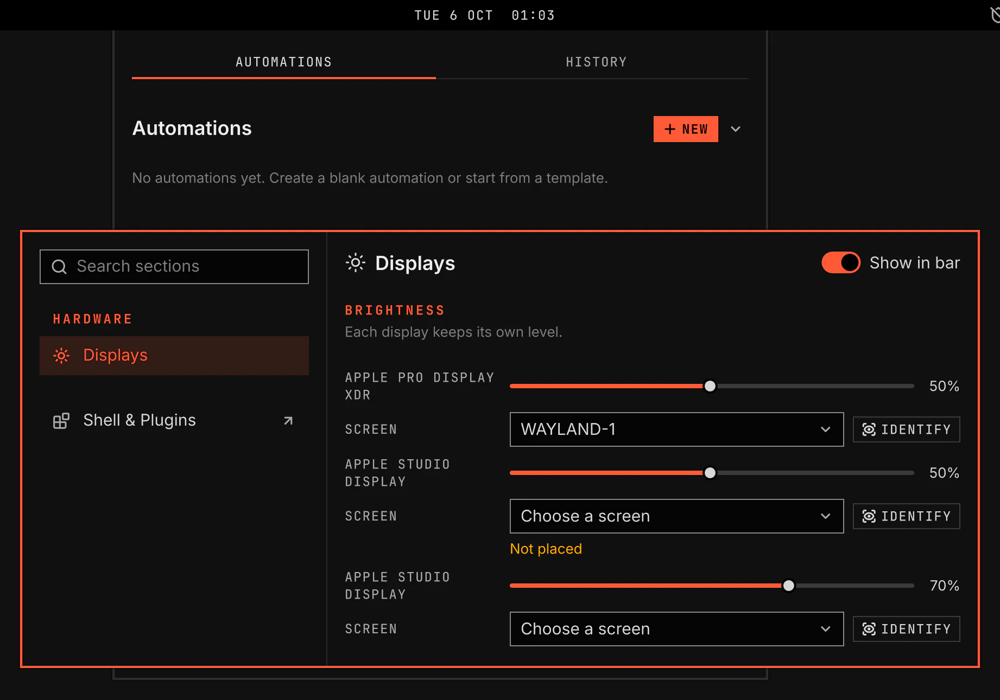

# System Settings

System Settings is one window for every system section, such as sound, displays and network. A sidebar lists the sections under their groups, and the chosen section fills the page beside it. System Settings and its Packages page stay on. You can turn other sections on or off in Plugins.

The [Displays](../vgs.displays/README.md) and [Sound](../vgs.sound/README.md) READMEs show their sections.

## Features

- `SUPER+COMMA` opens and closes the window. Change the key under Keys on the plugin's Settings page.
- Settings > System Settings in the launcher, or a section's own Settings link, opens the window.
- Type to find a section, and use the arrow keys and Enter to open it.
- General > Packages holds the update options and the shared agent review choices.
- Show in bar on a section's page puts its bar widget in the bar or takes it out.
- Shell & Plugins at the foot of the sidebar opens the Plugins window.
