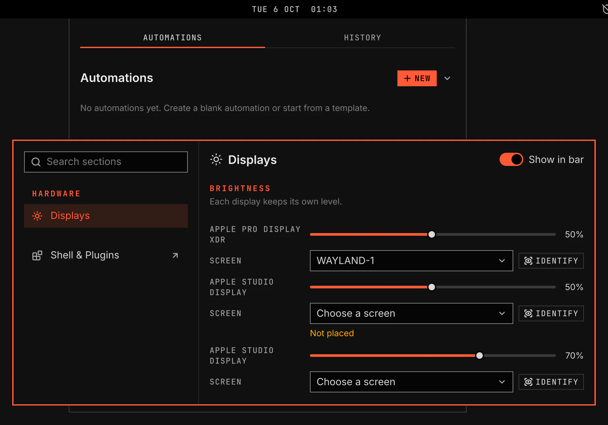

# System Settings

System Settings is one window for every system section, such as sound, displays and network. A sidebar lists the enabled sections under their groups, and the chosen section fills the page beside it. System Settings and its Packages page stay on. You can turn other sections on or off in Plugins. A group with no enabled section is not shown.

The [Displays](../vgs.displays/README.md) and [Sound](../vgs.sound/README.md) READMEs show their sections.

## Features

- `SUPER+PERIOD` opens the window on the section shown last, or the first. The same key closes it. Change the key under Keys on the plugin's Settings page.
- A section's own Settings link opens the window on that section.
- General > Packages holds the update options and the shared agent review choices.
- Settings > System Settings in the launcher opens the window.
- The window opens with the keyboard in the search field. Typing filters the sections.
- Up, Down, Page Up, Page Down, Ctrl+Home and Ctrl+End move the selection. Enter opens the selected section.
- Escape in a section returns to the search field. There it clears the search, then closes the window.
- A section you turn off while the window is open leaves the sidebar, and the window shows the first section left. A section you turn on joins the sidebar at once.
- Show in bar on a section's page puts its bar widget in the bar or takes it out. The section stays on.
- Fresh installs place Sound, Network, Bluetooth, Displays, Keyboard and VPN in the bar. Mouse stays off the bar. A widget can hide when it has nothing to show.
- Shell & Plugins at the foot of the sidebar opens the Plugins window.
- The window floats centred. Hyprland moves, resizes, tiles and closes it like any other window.
