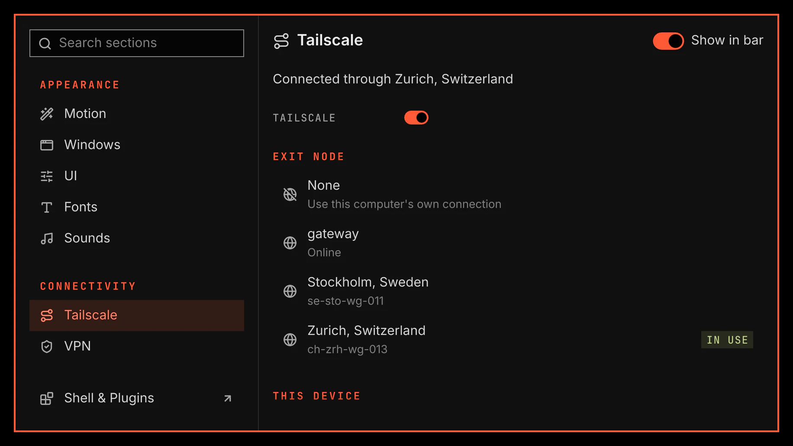

# Tailscale

Tailscale connects this computer to your tailnet. It turns the connection on and off, chooses an exit node, switches accounts and signs in. It has a bar icon with a flyout, and a Tailscale section in System Settings.

## Features

- A route icon shows the connection state and changes to a globe with a lock while an exit node is in use. It hides while Tailscale or its service is absent.
- A flyout holds the connection switch, Sign in while you are signed out, and the exit nodes. Tailscale settings opens the System Settings section.
- The System Settings section shows the same controls, this device, your accounts and your other devices.
- The switch turns Tailscale on and off and leaves your Tailscale settings as they are.
- The exit node list holds None, your network's exit nodes by name, and one Mullvad node for each city. A long list shows a limited number of nodes and keeps the node in use.
- Enter or a click routes your traffic through the selected exit node. None turns the exit node off.
- Sign in and Add account open the Tailscale sign-in page in your browser. A click on an account switches to it.

## Setup

The Tailscale service step on the plugin's Setup tab offers one step at a time. Enable and Let my login control Tailscale run in a setup window that shows its commands and asks before it runs them. While Tailscale is not installed, select Review all missing or outdated tools under Optional tools on the Setup tab.

| Step | When | What it does |
| --- | --- | --- |
| Enable | The Tailscale service is off | Starts the service and keeps it on after a restart. |
| Let my login control Tailscale | The administrator holds Tailscale | Lets VGS connect, disconnect and choose an exit node for you without a password. |

Check every sets how often VGS reads Tailscale while the flyout and the section are closed.

Tailscale is a registered trademark of Tailscale Inc. VGS is not affiliated with or endorsed by Tailscale Inc.
