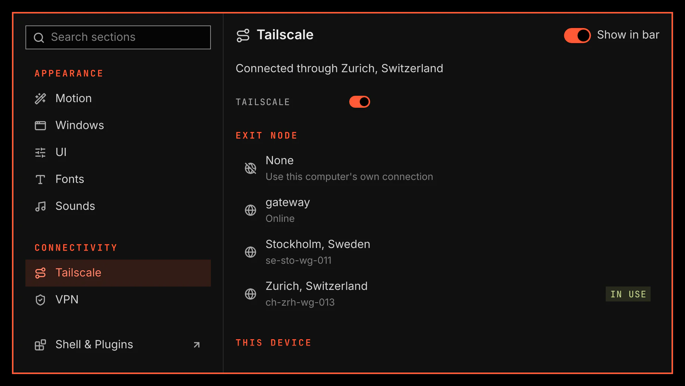
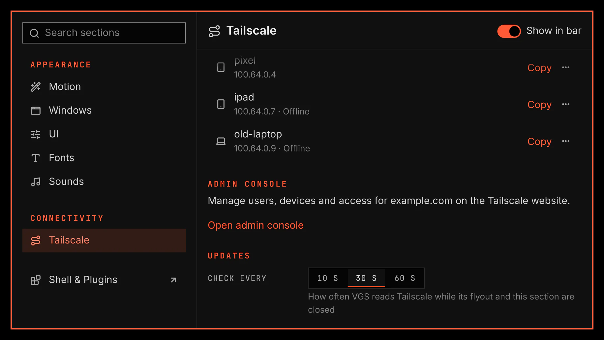

# Tailscale

Tailscale connects this computer to your tailnet. It turns the connection on and off, chooses an exit node, switches accounts and signs in. It has a bar icon with a flyout, and a Tailscale section in System Settings.

## Features

- A bar icon that shows the connection state and whether an exit node is in use.
- A switch that turns Tailscale on and off and leaves your Tailscale settings as they are.
- Saved accounts: switch between them, add one, sign in and sign out.
- This device and your network devices, with their addresses to copy.
- Connect in terminal opens an ssh session to a network device.
- Exit nodes: Tailscale's recommendation, your own nodes, and Mullvad by country and city.
- Open admin console opens the Tailscale admin console, which holds users, access, device approval and device removal.

## Setup

While Tailscale is not installed, System Settings › Tailscale offers Install Tailscale. The Tailscale service step on the plugin's Setup tab then offers one step at a time. Each runs in a setup window that shows its commands and asks before it runs them.

| Step | When | What it does |
| --- | --- | --- |
| Enable | The Tailscale service is off | Starts the service and keeps it on after a restart. |
| Let my login control Tailscale | The administrator holds Tailscale | Lets VGS connect, disconnect and choose an exit node for you without a password. |

Sign out asks first, because an admin may need to approve this computer again after it signs in. Add account and Sign in need a recent Tailscale; with an older one, the Optional tools step on the Setup tab offers the update. Connect in terminal needs ssh, and offers to install it while it is missing.

Tailscale is a registered trademark of Tailscale Inc. VGS is not affiliated with or endorsed by Tailscale Inc.
