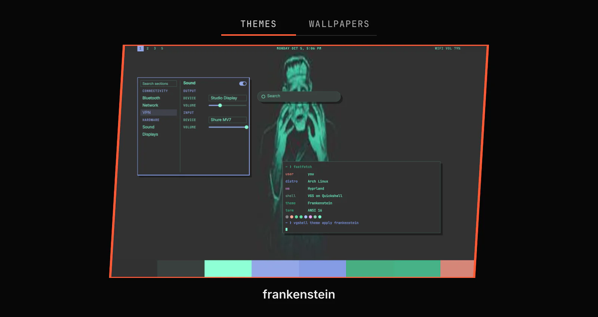

# Themes

Themes changes your desktop colours and wallpaper. Select a theme to apply it to VGS and the applications a theme reaches.



## Features

- A full-screen theme browser on `SUPER+SHIFT+T`. It shows shipped, installed and catalog themes as cards in one list, with the selected theme's name under the cards and each side card's name along its edge. The selection opens on the applied theme. Type to filter, and Enter applies the selected theme. A catalog theme installs first.
- A full-screen wallpaper browser on `SUPER+SHIFT+W`. It opens on the applied theme's wallpapers. Show all, under the cards, lists every theme's wallpapers and your own in `~/.config/vgshell/backgrounds/`; Show theme goes back. A package can show a short wallpaper name, and typing filters by that name or by the image file name. Enter sets the selected image.
- With two or more monitors, the wallpaper browser sets the image on All monitors or on This monitor alone.
- A catalog of themes VGS ships. Install adds a theme, and Download wallpapers fetches its wallpapers. After a catalog theme applies without its wallpapers, the browser offers to download them.
- A Themes panel on `SUPER+CTRL+J`. One row per theme shows its colours, and a click applies it. The Wallpaper section shows the applied theme's previous or next wallpaper. Add from URL installs a theme from a git address.
- A Modified badge on the applied theme when its file no longer matches the theme. Applying the theme again reverts the edit.
- Style in the launcher opens the theme browser, the wallpaper browser and the No window gaps switch.
- `SUPER+SHIFT+BACKSPACE` removes the space around and between tiled windows, or gives it back.
- Chromium, Google Chrome, Microsoft Edge and Brave take the theme's background colour. The Arch and Fedora packages set this up for every user. On a home install, Install browser theming, an optional step on the plugin's Setup tab, opens a terminal where sudo asks for your password.
- Each shortcut changes under Keys on the plugin's Settings page.

<details><summary>Show command</summary>

```bash
vgshell theme browser-policy install
```

</details>

## Setup

| Setting | What it changes |
| --- | --- |
| Panel position | Where the panel opens when you use its shortcut. |
| No window gaps | Removes the space around and between tiled windows on every workspace. |

Window corners, borders and animations are on the Windows and Motion pages under Settings > Appearance.

## Browser keys

Each browser shows one hint under the cards that names what typing searches. The theme browser shows Type a theme name to search. The wallpaper browser shows Type a wallpaper or image file name to search, beside Show all or Show theme. These keys work in both:

| Key | What it does |
| --- | --- |
| Left, Right, Up, Down | Select the previous or next card. |
| Home, End | Select the first or last card. |
| Enter | Applies the selected theme, or sets the selected wallpaper. |
| Esc | Clears the filter, then closes the browser. |
| Tab, Shift+Tab | Switch between the theme browser and the wallpaper browser. |

Typing filters the cards, and what you typed shows under them in place of the hint. Backspace erases a character, Ctrl+Backspace a word and Ctrl+U the whole filter. In the wallpaper browser, Alt+S does what Show all and Show theme do, and Alt+M switches between All monitors and This monitor.
