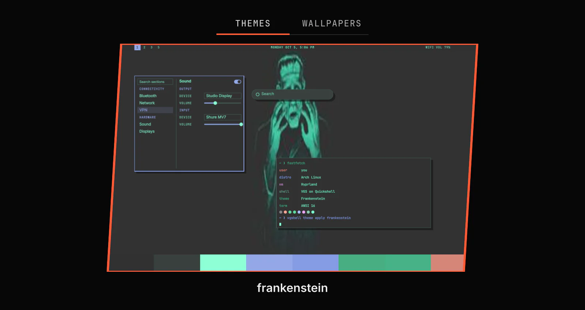

# Themes

Themes changes your desktop colours and wallpaper. Select a theme to apply it to VGS and the applications a theme reaches.



## Features

- A full-screen theme browser on `SUPER+SHIFT+T`. Type to filter, and Enter applies the selected theme. A catalog theme installs first.
- A full-screen wallpaper browser on `SUPER+SHIFT+W`, with the applied theme's wallpapers, every theme's wallpapers and your own. With two or more monitors, it sets the image on all of them or on one.
- A catalog of themes VGS ships. Install adds a theme, and Download wallpapers fetches its wallpapers.
- A Themes panel on `SUPER+CTRL+J` to apply a theme, change the wallpaper, or install a theme from a git address.
- A Modified badge when the applied theme's file no longer matches the theme. Applying the theme again reverts the edit.
- Style in the launcher opens both browsers and the No window gaps switch.
- `SUPER+SHIFT+BACKSPACE` removes the space around and between tiled windows, or gives it back.
- Chromium, Google Chrome, Microsoft Edge and Brave take the theme's background colour.
- Each shortcut changes under Keys on the plugin's Settings page.

## Setup

Browser theming needs a one-time step. The Arch and Fedora packages set it up for every user. On a home install, Install browser theming, an optional step on the plugin's Setup tab, opens a terminal where sudo asks for your password.

<details><summary>Show command</summary>

```bash
vgshell theme browser-policy install
```

</details>

| Setting | What it changes |
| --- | --- |
| Panel position | Where the panel opens when you use its shortcut. |
| No window gaps | Removes the space around and between tiled windows on every workspace. |

Window corners, borders and animations are on the Windows and Motion pages under Settings > Appearance.
