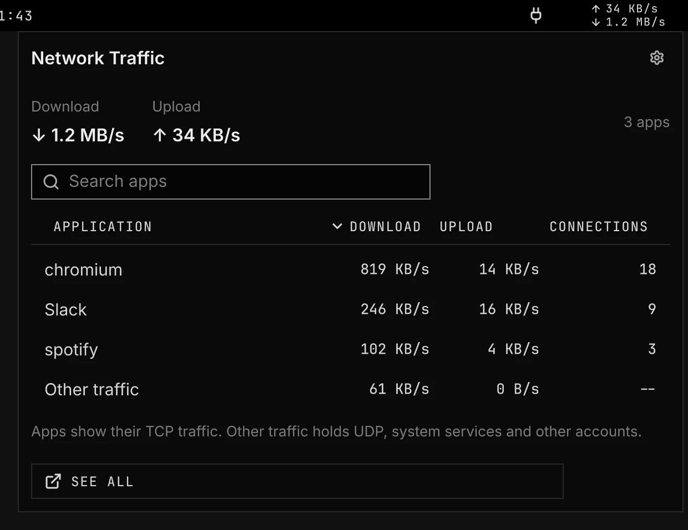

# Network Traffic

See download and upload speeds in the bar. Click the widget to see traffic per app.



## Features

- Download, upload, or both speeds in the bar, stacked or on one line.
- Search apps and sort them by download, upload or connection count.
- Click an app to see its processes and TCP connections, or to kill it. Kill asks first.
- Traffic from system services, other accounts and other protocols, under Other traffic.
- See all opens the complete traffic view.

## Setup

Open Plugins > Network Traffic to change the layout, labels, refresh interval and speeds shown.

See all needs bandwhich, an optional tool. While it is missing, the Traffic capture step on the Setup tab offers Review all missing or outdated tools. Once it is installed, the step offers Allow traffic capture when capture access is needed. Allowing it lets every account on this computer see network traffic through bandwhich. Capture works only with a bandwhich from your system's packages. A package update can remove capture access; reopen this page to check it again.

<details>
<summary>Show command</summary>

Allow traffic capture grants these permissions to the installed bandwhich:

```sh
setcap cap_sys_ptrace,cap_dac_read_search,cap_net_raw,cap_net_admin+ep /usr/bin/bandwhich
```

The See all terminal runs:

```sh
bandwhich
```

</details>

## Licence

[MIT](../../../LICENSE)
