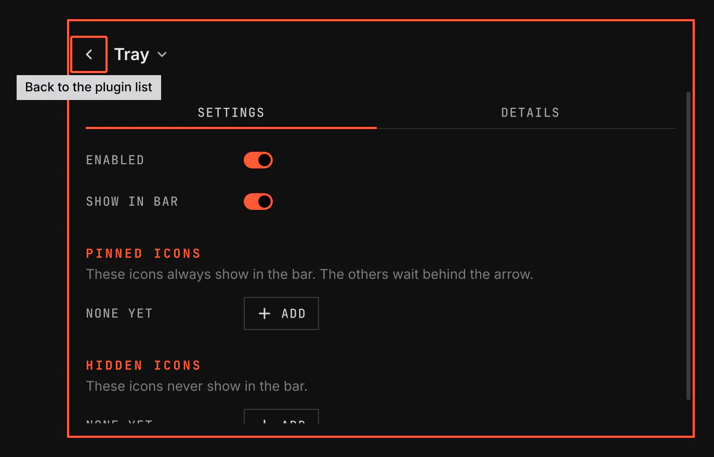

# Tray

Tray shows app icons in the bar, such as chat, sync, VPN and media apps. Use an icon to open the app or its menu.

## Features

- Every app that shows a tray icon, in the bar.
- A drawer behind the arrow holds the icons. Rest the pointer on the arrow to open it, or click the arrow to keep it open.
- Pinned icons always show next to the arrow. Hidden icons never show.
- Left-click an icon for the app's main action, or its menu if the app offers only a menu. Middle-click for its second action. Scroll to change what the app controls, such as its volume.
- Right-click an icon to open the app's menu. An entry with an arrow opens its submenu in the same menu, and Back returns to the level above.
- Right-click the arrow and choose Manage tray icons to pin or hide each icon. The same menu hides the whole tray.

## Setup

Use Manage tray icons, or open Plugins > Tray to change Pinned icons and Hidden icons. In Plugins, a new list item takes effect only after you choose an app. An app that is not running keeps its place in the list.

## Licence

Parts of Tray are adapted from Omarchy under the MIT licence. [LICENSE](LICENSE) names the files.
