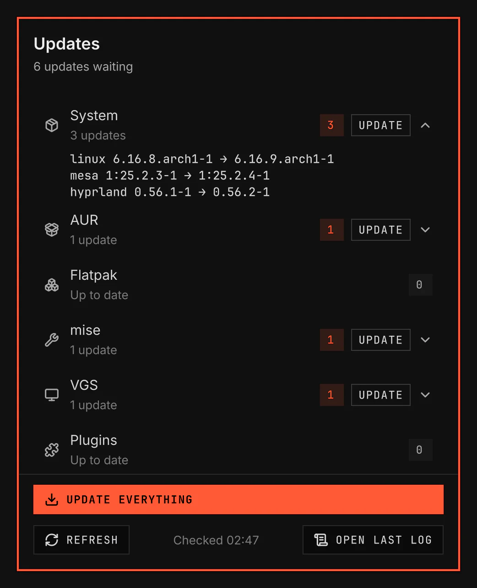

# Updates

Updates checks your system, VGS, plugins, themes and developer tools for updates, and installs them. Its bar icon shows how many wait.

## Features

- Checks system packages, AUR packages, verified packages such as gliff, Flatpak apps, mise tools, VGS itself, installed plugins and installed themes.
- A bar icon with the count of waiting updates, and a warning when a check fails.
- A window on `SUPER+U` or a click on the icon, with one row per source. Update installs one source, and Update everything installs all of them.
- Open last log shows the log of the last update run.
- A system snapshot before updates when Snapper or Timeshift is installed and set up.
- An optional AI review of Arch system and AUR packages before installation. A flagged package lets you skip it or install it anyway.

## Setup

Open Plugins > Updates to change the check interval, icon visibility and update options. System snapshot can turn snapshots off. Trust plugin and theme updates applies those changes without asking first.

Package review settings in the Updates window opens System Settings > General > Packages, where you choose how AI reviews packages.

On CachyOS, Reboot notice controls whether CachyOS also shows restart notices for updates outside VGS. VGS asks once after an update that needs a restart with either choice.
