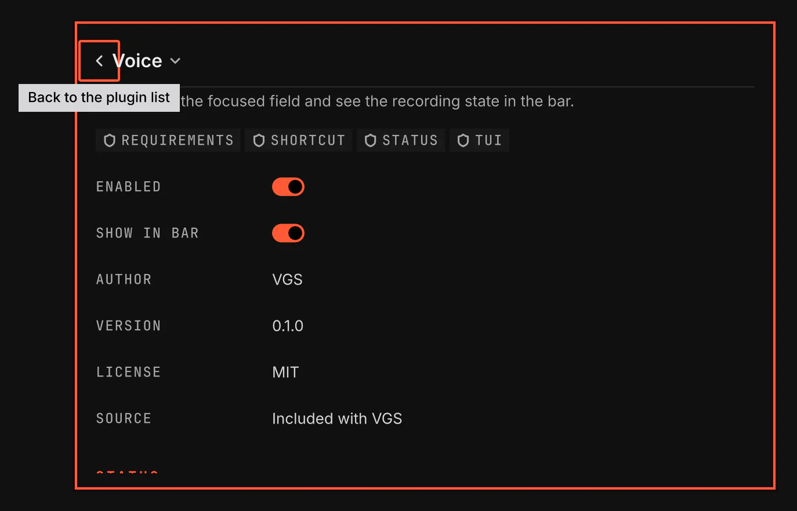
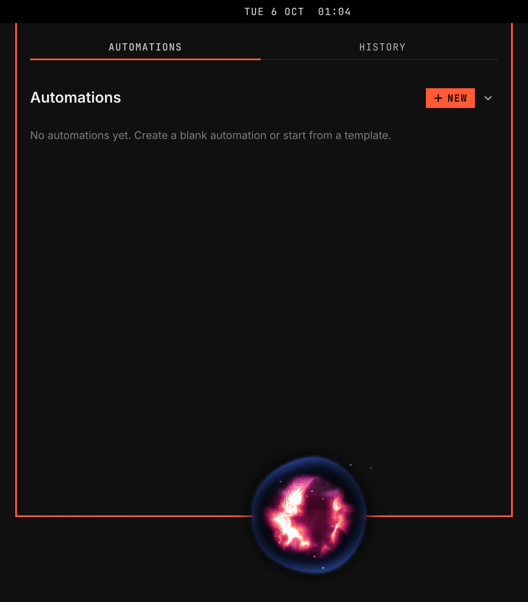

# Voice

Voice types what you say into the focused field. It uses voxtype to record and recognise your speech, and puts a mic in the bar's right section.

## Features

- `SUPER+CTRL+X` starts dictation, and a second press stops it.
- `F9` dictates while you hold it.
- A tap of Right Alt or Right Ctrl, pressed and released alone, starts and stops dictation. Right Alt used as AltGr with another key types as usual.
- Each key changes under Keys on the plugin's Settings page.
- A plasma orb at the bottom centre of the focused screen swells with your voice while you speak and pulses while your words are recognised. It takes no key and no click.
- A tone plays when dictation starts, stops or fails. Sounds in System Settings turns the tones off or on.
- The bar mic uses the accent colour while recording and spins while your words are recognised. A click starts dictation, and a second click stops it. Without voxtype, a click offers to install it. A right click shows Voxtype Settings, which opens Configure.
- Configure and Choose model open voxtype's own screens. Voice warns first when your voxtype config is a symlink, because those screens can replace it. VGS starts voxtype again when either screen closes, so your change applies.
- VGS runs voxtype while a plugin that dictates is on, and stops it when the last one is turned off. voxtype makes one recording at a time: while another plugin records, a Voice key starts nothing, the mic stays idle, and Voice dictates again once that recording ends.

## Setup

The Setup tab of the Voice page shows each required step as Done or To do. The Tools step names missing tools. Select Review all missing or outdated tools to open the install notice.

Set up copies the default voxtype config when you have none, adds the start and stop sounds, enables the speech engine and downloads the speech model. A step that needs your password says so before it asks. VGS then starts voxtype itself, and runs it while a plugin that dictates is on; Voice needs no voxtype service of your own. If another voxtype is already running, the Details tab offers Stop the other voxtype beside Other dictation service. It shows the voxtype service it found and asks before it turns that service off. It removes the service file only when it is your own, and keeps a service a package installed. VGS then starts its own voxtype without a restart. When no service started the other voxtype, the step changes nothing and asks you to close that voxtype; press Stop the other voxtype again once it is closed, and VGS starts its own.

| Setting | What it changes |
| --- | --- |
| On-screen display | `plasma`, the default orb, `ring` for the VGS voice ring, or `off`. |
