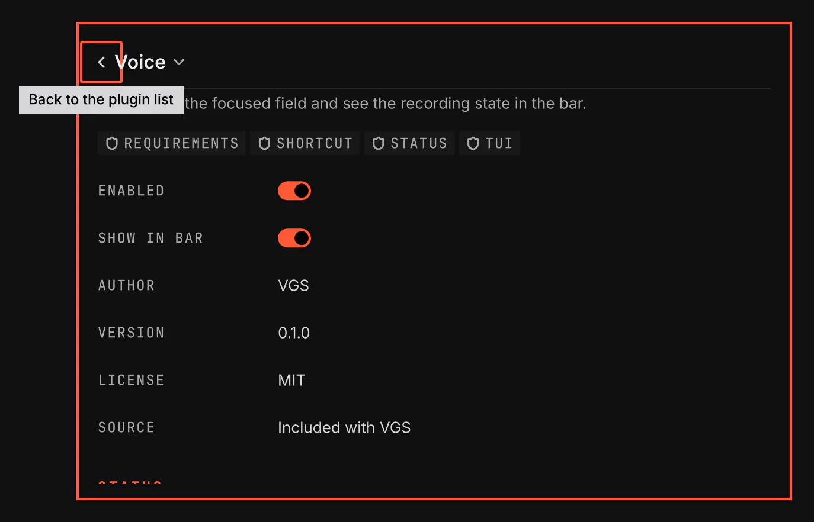
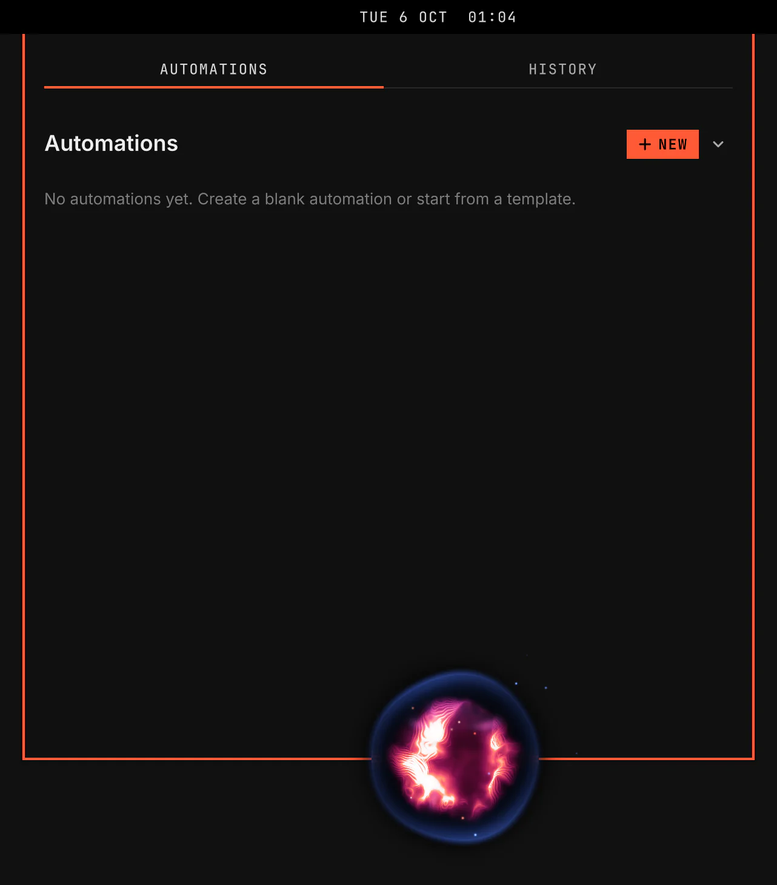

# Voice

Voice types what you say into the focused field. It uses voxtype to record and recognise your speech, and puts a mic in the bar's right section.

## Features

- `SUPER+CTRL+X` starts dictation, and a second press stops it.
- `F9` dictates while you hold it.
- A tap of Right Alt or Right Ctrl, alone, starts and stops dictation. Right Alt as AltGr types as usual.
- An orb on screen that moves with your voice while you speak.
- A tone when dictation starts, stops or fails. Sounds in System Settings turns the tones off or on.
- A bar mic that shows when Voice records. A click starts and stops dictation.
- Configure and Choose model open voxtype's own settings and model choice.
- Each key changes under Keys on the plugin's Settings page.

## Setup

The Setup tab of the Voice page shows each required step. The Tools step names missing tools. Select Review all missing or outdated tools to open the install notice.

Set up prepares voxtype and downloads the speech model. A step that needs your password says so before it asks. VGS then runs voxtype itself; Voice needs no voxtype service of your own. If another voxtype is already running, the Setup tab offers Stop the other voxtype under Other dictation service, and asks before it turns that service off.

| Setting | What it changes |
| --- | --- |
| On-screen display | `plasma`, the default orb, `ring` for the VGS voice ring, or `off`. |
