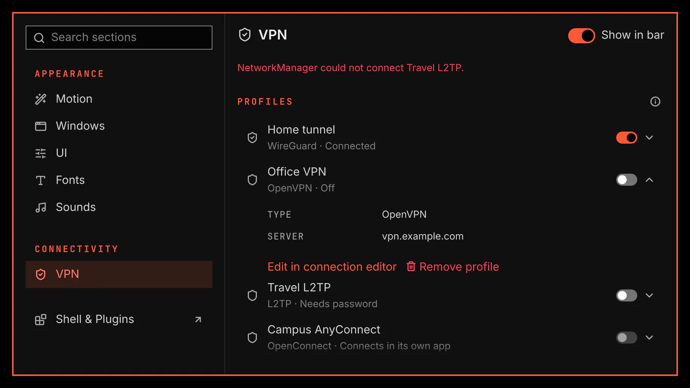
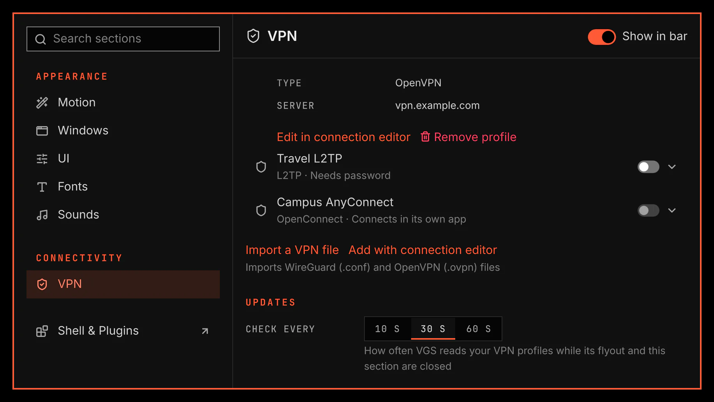

# VPN

VPN connects your saved NetworkManager VPN and WireGuard profiles. It has its own bar icon, flyout and VPN section in System Settings.

## Features

- A shield icon shows whether a profile is connected. It turns while a profile connects or disconnects, and shows a warning after a profile could not connect or needs its password. It hides while NetworkManager is unavailable or no VPN or WireGuard profile is saved.
- Each profile has a connection switch in the flyout and in System Settings. Its line gives its type and state, and when a profile cannot connect here, its switch says why.
- An OpenVPN profile that needs NetworkManager's OpenVPN plugin offers Install plugin beside its disabled switch. Installing the plugin makes the profile available to connect.
- When an OpenVPN, L2TP, PPTP, SSTP or Fortinet SSL profile asks for its password, its line reads Needs password and its switch opens a password prompt. After a connect with a password fails, the prompt opens again and says that NetworkManager could not connect with this password.
- Open a profile to see its type, its server and, while it is connected, its address.
- Import a VPN file opens a file picker in a setup window. It imports WireGuard (.conf) and OpenVPN (.ovpn) files, and NetworkManager stores the imported profile and its keys.
- Add with connection editor and Edit in connection editor, in System Settings, open NetworkManager's own editor to make or change a profile. VGS offers to install the editor when it is missing.
- Remove profile, in an open profile in System Settings, deletes the profile after you confirm, with the passwords and keys saved in it. Key and certificate files that the profile uses stay on this computer.

## What VGS can connect

- **Import:** WireGuard (.conf) files, and OpenVPN (.ovpn) files, which need NetworkManager's OpenVPN plugin. No other file type imports.
- **Connect and disconnect:**
  - every WireGuard profile whose private key NetworkManager holds;
  - every NetworkManager VPN profile other than OpenConnect whose NetworkManager plugin is installed and whose passwords NetworkManager holds;
  - an OpenVPN, L2TP, PPTP, SSTP or Fortinet SSL profile that asks for its password, through the password prompt.
- **Details:** the type, the server and, while connected, the assigned address.
- **Add or edit:** use Add with connection editor under the profile list, or Edit in connection editor in an open profile. NetworkManager's editor saves the profile. VGS lists the changes at its next read.
- **Remove:** any profile, after you confirm. NetworkManager deletes the profile with the passwords and keys saved in it. Key and certificate files that the profile uses stay on this computer.
- **Not supported:** OpenConnect profiles (Cisco AnyConnect, GlobalProtect, Pulse or Ivanti), a VPN that signs in through a web page, a profile that asks for a secret other than its password or a one-time code when it connects, a smart card or certificate passphrase, and a profile of any other type that asks for a secret when it connects. These profiles still show with their details, Edit in connection editor and Remove profile. The switch of an OpenConnect profile says why it cannot connect; the switch of another such profile says why after a connect fails.

## The password

VGS gives the password you type to NetworkManager for that one connect and keeps no copy. NetworkManager keeps it only where the profile's own password setting says to keep it.

- The NetworkManager tool that VGS connects with removes spaces and tabs at the start and end of a password, and reads a backslash as the start of an escape. VGS escapes these characters, so the password arrives as you typed it.
- No VPN type tells NetworkManager that a password was wrong, apart from other connect failures. So after a failed connect VGS says that NetworkManager could not connect with this password, and does not say that the password was wrong.

## Setup

System Settings › VPN stays available when the bar icon hides. It shows your saved profiles when NetworkManager answers. Import a VPN file adds a WireGuard or OpenVPN file to NetworkManager. Add with connection editor makes a profile, including a VPN that has no file to import. Open a saved profile and use Edit in connection editor to change it or save the sign-in details it needs. Both actions offer to install NetworkManager's editor when it is missing. OpenVPN profiles and OpenVPN (.ovpn) imports need NetworkManager's OpenVPN plugin. Use Install plugin on an OpenVPN profile, or open Settings › Plugins › VPN › Setup and review Optional tools. Details lists the plugin under Tools.

Check every, in the Updates section, sets how often VGS reads your profiles while the flyout and the section are closed.
