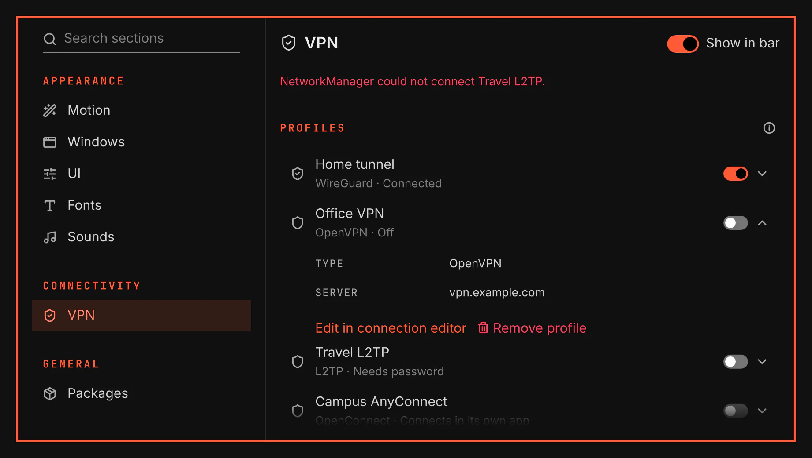
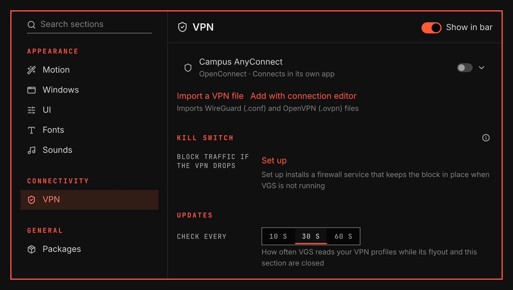

# VPN

VPN connects your saved NetworkManager VPN and WireGuard profiles. It has its own bar icon, flyout and VPN section in System Settings.





## Features

- A shield in the bar that shows whether a profile is connected or needs you.
- A connection switch for each profile, in the flyout and in System Settings. When a profile cannot connect here, its switch says why.
- A password prompt for a profile that asks for its password.
- A profile's type, server and, while connected, its tunnel address.
- For a connected WireGuard profile, the public address, country and city that sites see, and a leak check for IPv4, IPv6 and name lookups.
- Import a VPN file imports WireGuard (.conf) and OpenVPN (.ovpn) files.
- NetworkManager's connection editor to add or edit a profile.
- Remove profile deletes a profile after you confirm.
- A kill switch that blocks traffic outside the VPN when the VPN drops.

## What VGS can connect

- **Import:** WireGuard (.conf) files, and OpenVPN (.ovpn) files, which need NetworkManager's OpenVPN plugin.
- **Connect:** WireGuard profiles; NetworkManager VPN profiles other than OpenConnect whose plugin is installed and whose passwords NetworkManager holds; and OpenVPN, L2TP, PPTP, SSTP or Fortinet SSL profiles that ask for their password.
- **Not supported:** OpenConnect profiles (Cisco AnyConnect, GlobalProtect, Pulse or Ivanti), a VPN that signs in through a web page, and a profile that asks for anything other than its password when it connects, such as a one-time code or a smart card. These profiles still show, with Edit in connection editor and Remove profile.

## Setup

System Settings › VPN lists your saved profiles. Import a VPN file adds a WireGuard or OpenVPN file. Add with connection editor makes a profile, including a VPN with no file to import. Edit in connection editor, in an open profile, changes it or saves the sign-in details it needs. VGS offers to install the editor when it is missing.

OpenVPN profiles need NetworkManager's OpenVPN plugin. Use Install plugin on an OpenVPN profile, or Optional tools on the plugin's Setup tab.

VGS gives the password you type to NetworkManager for that one connect and keeps no copy. NetworkManager keeps it only where the profile's own password setting says to. Remove profile deletes the passwords and keys saved in the profile; the key and certificate files it uses stay on this computer.

Check every, in the Updates section, sets how often VGS reads your profiles while the flyout and the section are closed.

## Public address and leak check

An open connected WireGuard profile shows the public IPv4 address that sites see, with its country and city, and a leak check. VGS checks once after you connect the profile here, and again each time you press Check. It never checks on a timer. Other VPN profiles have no check: NetworkManager does not tell VGS which network their tunnel uses.

The leak check asks no outside service. It reads this computer's own settings first:

- **IPv4 and IPv6:** which network traffic to the internet leaves by. In the VPN passes. A route out of another network is a leak, unless the kill switch blocks it.
- **DNS:** which DNS servers systemd-resolved sends name lookups to. Lookups that go only to the VPN pass. A lookup that can go to another network, such as the Wi-Fi's own DNS server or a Wi-Fi domain, or to DNS servers set for the whole computer, is a leak, unless the kill switch blocks it. Tailscale's own names, its MagicDNS names and the reverse names of its addresses, going to Tailscale are no leak. Any other domain Tailscale sends to its DNS server is a leak. When `/etc/resolv.conf` does not point programs at systemd-resolved, DNS reads Could not check: programs that read that file ask the servers it lists directly.
- **Kill switch:** while it is on, how many times it refused traffic. When the VPN drops while the kill switch is on, Check on the dropped profile reads Holding with the count, and the count at the last check when it rose since then.

Then, for the public address, VGS asks one outside service, `api.nordvpn.com`, NordVPN's own. It asks through the VPN only, and only when the lookup of the service's own name stays in the VPN or the kill switch blocks it everywhere else. It never asks while no profile is connected. The service learns the address the question comes from, which is the address every site you open sees. When VGS does not ask, the row reads Not checked and says why. When the service does not answer or sends an answer VGS cannot read, the row reads Could not check and says why.

A reading VGS cannot take reads Could not check, never a pass. A connection that ends during a check stops its question to the service. A connection that ends after a check clears its result.

## Kill switch

Block traffic if the VPN drops, in the flyout and in the VPN section, turns the kill switch on. When a VPN you turned on in VGS drops, the kill switch blocks traffic outside it until the VPN connects again or you turn the VPN off in VGS. The block stays in place while VGS is not running and after a restart. It works with WireGuard profiles.

The first time, Set up in the kill switch row opens a terminal that shows the setup and asks for your password once. The setup installs a firewall service that holds the block.

With the kill switch on, VGS connects a profile only after the block is in place. When the block does not start within two seconds, VGS does not connect the profile and says why. VGS also does not connect a profile the kill switch cannot use, such as one that is not WireGuard.

Allow local network keeps printers, shared folders and other devices on your network reachable while the block holds. Name lookups still go through the VPN only.

Containers and virtual machines on this computer work only with Allow local network on. Without it, the block also refuses the traffic between this computer and its own containers and virtual machines, so a virtual machine on libvirt's default NAT network gets no address and no name lookups.

The block also covers a virtual machine or container attached at layer 2: on macvtap, macvlan or ipvlan, or on a bridge that holds this computer's network connection. The network card refuses its traffic. Traffic that is not IPv4 or IPv6, such as ARP, still passes.

When the kill switch cannot check a network device, the kill switch row says so in red: traffic can go out through that device without the VPN. On Linux before 6.16, the kill switch cannot check network devices, so the row always shows this. There the block covers this computer's own traffic and the traffic it routes for its containers and virtual machines, but not traffic at layer 2.

The kill switch does not cover a network card that a container moves into its own network namespace. While the block holds, it also refuses the replies to containers on netkit devices, as Cilium sets up for Kubernetes pods, when this computer masquerades their traffic.

While the block holds after a drop, the flyout and the VPN section show a red notice at their top, and the profile reads Dropped with its switch on. The notice's Turn VPN off button, or that switch, turns the VPN off on purpose and ends the block. The kill switch row then shows how many times the kill switch refused traffic since it last started.

Reconnect, in the dropped profile's opened row, connects the profile again and keeps the block in place while it retries. Turn VPN off or the profile's switch ends the block.

Only the profile's switch in VGS, Turn VPN off in that notice and the kill switch's own off command turn the VPN off on purpose. A drop, nmcli in a terminal or nm-applet's switch leaves the block in place. So does a connect that NetworkManager does not complete: the block holds until the VPN connects or you turn it off in VGS.

The off command turns the VPN off on purpose while VGS is not running, and needs no password while the firewall service runs. When that service is broken, NetworkManager is not running or VGS is removed, the same command as root clears the block.

<details><summary>Show command</summary>

```sh
# Set up
vgshell system apply vpn-kill-switch
# VPN off on purpose while VGS is not running
vgs-kill-switch off
# Clear the block: service broken, NetworkManager not running or VGS removed
sudo vgs-kill-switch off
```

</details>
