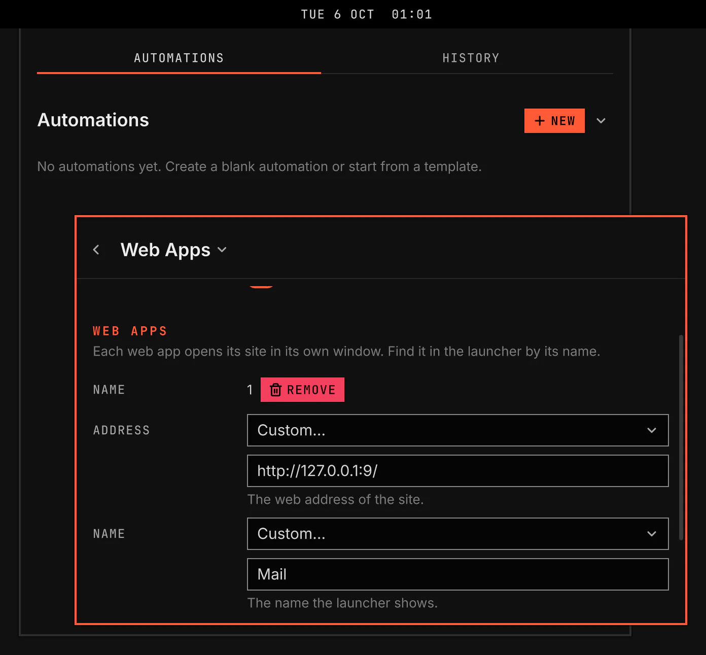

# Web Apps

Web Apps turns a website into an app. Each web app has its own name and icon in the launcher, and opens its site in its own window of the browser you already have.

## Features

- Add, change and remove web apps on the Web Apps page in Plugins. No file to edit.
- Find each web app in the launcher by its name, with the site's icon.
- Select a web app to open its site in a window of its own, without tabs or an address bar.
- Select it again while its window is open, and VGS brings that window into view, on whatever workspace it is.
- Remove a web app, and its launcher entry and icon go with it.

## Setup

Open Plugin settings from the launcher and choose Web Apps. On Settings, add an entry under Web apps and choose its Address. Pick a common site or choose Custom… to enter another address.

Leave Name and Icon empty to use the site's own name and icon. To choose another icon, use Custom… and give the full path or web address of an image.

A web app needs a Chromium-family browser, such as Chromium, Google Chrome or Brave. VGS uses your default browser when it supports app windows, or another installed Chromium-family browser. Firefox is not supported. Details shows the chosen browser or warns when none is available.

Turning off or removing Web Apps leaves its web apps in the launcher. Remove them on the Web Apps page first.
