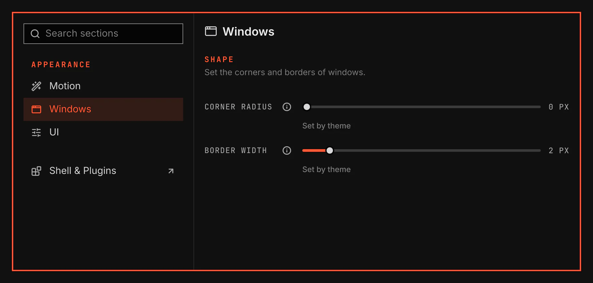

# Windows

Windows sets the corner radius and the border width of windows and flyouts, and VGlass, the frosted glass of the launcher, notifications and windows. It is for anyone who wants rounder, squarer or thinner window edges than the theme gives, or more or less glass.

It also gives you a key that locks a window group, and tells you whether the group is locked or unlocked.

## Features

- A Windows section under Appearance in the System Settings window.
- Each value shows Set by theme until you change it. Use theme value puts the theme's value back.
- One corner radius sets three shapes: windows use the full radius, flyouts three quarters of it and grouped window tabs half of it.
- A value you set applies over your own Hyprland config. Where your config sets another value, the row shows that value and offers Use my Hyprland value, which makes VGS stop setting it.
- VGlass is on for every glass surface, off for every glass surface, or each surface's own choice. The glass surfaces are the launcher, notifications and your windows. The launcher and notifications have a VGlass setting each and use glass by default.
- With VGlass on for windows, Hyprland draws your windows with blur, transparency and a shadow. Off, Hyprland keeps the window look from your own Hyprland config.
- The values stay in effect when you disable this plugin. Enable it again to change them.
- `SUPER+CTRL+G` locks the group of the focused window, or unlocks it. A notification tells you the result: Group locked with a lock, or Group unlocked with an open lock. No window can join or leave a locked group.
- A window in no group stays as it is, and no notification shows. Only this key sends the notification: a lock made another way, and a group you make, join or leave, sends none.
- When Hyprland reads a classic `hyprland.conf` and not `hyprland.lua`, VGS cannot read the lock of a group, so the key changes nothing and shows no notification.

## Values

| Value | What it changes |
| --- | --- |
| Corner radius | The corners of windows, flyouts and grouped window tabs, from 0 to 32 px. |
| Border width | The window border, from 0 to 20 px. Use my Hyprland value also keeps your own border colours. |
| VGlass | Each surface decides, On for every glass surface or Off for every glass surface: the launcher, notifications and your windows. Without glass a surface draws as a plain panel. |
| Windows | Whether Hyprland draws your windows with glass while each surface decides. |
| Glow | Whether Hyprland draws a soft glow inside your focused window while Windows glass is on. |

The key is under Keys on the plugin's Settings page.
