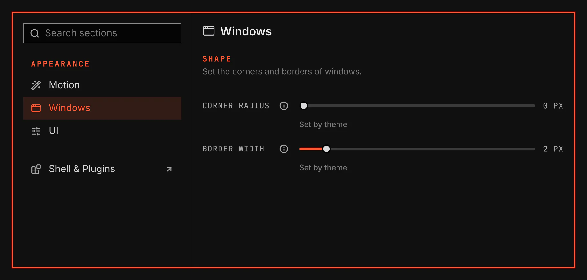

# Windows

Windows lets you change window corners and borders, and VGlass, the frosted glass of the launcher, notifications and windows.

It also gives you a key that locks a window group, and tells you whether the group is locked or unlocked.

## Features

- A Windows section under Appearance in the System Settings window.
- Each value shows Set by theme until you change it. Use theme value puts the theme's value back.
- A corner-radius control for windows, flyouts and grouped window tabs.
- VGlass on for every glass surface, off for every one, or each surface's own choice.
- The values stay in effect when you disable this plugin.
- `SUPER+CTRL+G` locks or unlocks the group of the focused window, and a notification tells you which. The key is under Keys on the plugin's Settings page.

## Setup

Open System Settings and choose Windows under Appearance. Change Corner radius and Border width, or use Use theme value to restore the theme's choice.

VGlass turns glass on or off for every glass surface, or lets each surface decide. With Each surface decides selected, Windows controls glass on your application windows. Glow adds a soft glow to the focused window while window glass is on.

A value you set applies over your own Hyprland config. Where your config sets another value, the row shows it and offers Use my Hyprland value, which makes VGS stop setting it. The group lock key needs `hyprland.lua`; with a classic `hyprland.conf` it changes nothing.
